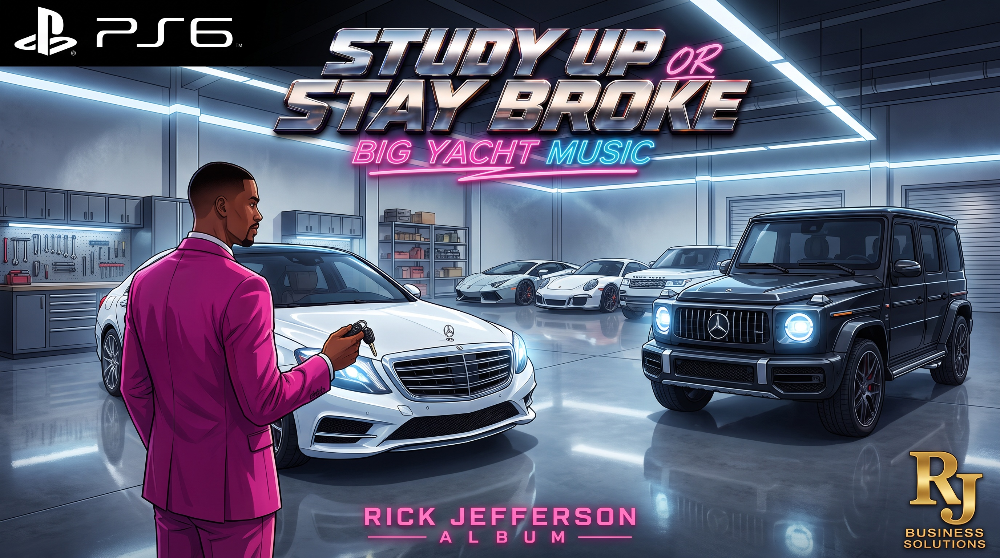

# Jukeyman Unleashed

### The reverse-engineering vertical of the Jukeyman system.

**Jukeyman is a super-intelligent, multi-vertical system. Each vertical owns a domain.
This vertical owns reverse engineering — taking any software apart, down to the binary.**

---

## What this is

**Jukeyman** is a super-intelligent system built as a family of **verticals** — each one a
deep, self-contained capability the system can call on. **Jukeyman Unleashed** is the
**reverse-engineering vertical**: hand it a piece of software and it takes it apart,
explains how it works, and proves every claim with evidence.

It is built on the complete upstream **REA** engine (`morluto/rea`), imported here in full,
wrapped in an RJ Business Solutions layer.

## What it does

Point it at a target. It inspects and traces the code, returns findings **with evidence**
(code, references, explicit unknowns — not guesses), and lets an agent ask follow-ups,
explain behaviour, or rebuild the feature inside your own project.

### Targets it can take apart

| Target | What comes back |
|---|---|
| Native binaries | Pseudocode, assembly, strings, symbols, calls, references |
| Offline ELF layout | Sections, segments, original symbols/relocations, mitigation candidates |
| Go binaries | Embedded compiler version, modules, replacements, build settings |
| Rust binaries | cargo-auditable crate names, versions, sources, dependency edges |
| WASM artifacts | Validation, sections, exact import/export WAT, decoded WAT |
| EVM bytecode | Dispatch selectors, byte offsets, inferred arguments, mutability |
| SQLite databases | Tables, columns, indexes, views, triggers, selected rows |
| Recorded Linux crashes | Registers, signals, per-thread state, mapping candidates |
| JavaScript / Electron apps | Modules, imports, source maps, routes, IPC, native add-ons |
| Websites | Page structure, scripts, network observations, screenshots |
| Saved network captures | Requests, responses, payloads, source locations |
| .NET assemblies | Metadata, CIL instructions, native deps, build comparison |
| Android APKs | Manifest, classes, decompiled methods, references |
| Android devices | Devices, packages, processes, logs, dumps, screen captures |
| JEB projects | Project units, artifact digests, pseudo-code |
| Android resources | Decoded manifest, string tables, locales, version facts |
| Flutter apps | Dart snapshot hashes, per-ABI library digests, engine provenance |
| Firmware | Regions, extraction results, native-analysis handoffs |
| Recorded packets | Fields, repeated values, filters, decode-as rules |
| Packet summaries | Endpoints, DNS, TLS SNI, protocol distribution, HTTP requests |
| Recorded logic signals | Decoder annotations, sample ranges, diagnostics |
| Packages & resources | Inventories, digests, plists, Apple bundle anatomy |
| Process behaviour | Terminal output, interactions, exit/filesystem observations |

### Engines it drives

Hopper · Ghidra · IDA · Kuna decompiler · JADX (Android) · pwntools · WABT · Binwalk / Unblob ·
TShark · sigrok · adb · Apktool · objdump · Rizin · Frida (runtime verification) · JEB

## How it works

1. **An agent asks** — over MCP, in plain language, about a local target.
2. **This vertical inspects** — it picks the right engine for the format and traces it.
3. **Evidence comes back** — code, references and explicit unknowns.
4. **The agent acts** — explains the behaviour, writes the feature, tests it.

Analysis runs **locally**; targets are not uploaded.

## Quick start

    npx rea-agents setup     # registers the MCP server + agent workflow, then restart your agent

Ask your agent:

> "Understand how search works in <app>, show me the evidence, and build it for my project."

From the terminal:

    npx -y rea-agents@latest analyze-javascript-application /absolute/path/to/app --json
    npm install --global rea-agents && rea --help

## Requirements

- Node.js 22.x (>=22.19), 24.x (>=24.11) or 26+, plus npm
- A deep-analysis engine for native work: Hopper, Ghidra or IDA
- Static JavaScript and .NET inspection need no native engine
- Linux targets may need extras (procps `ps`, pwntools, tshark…) — see `docs/`

## Repository map

    src/            engine (TypeScript)
    native/         native analysis bridge
    bridge/         engine integration
    third_party/    vendored tooling
    website/        site + docs assets
    docs/           complete upstream documentation
    tests/          test lanes
    .agents/        agent definitions        AGENTS.md   agent instructions
    server.json     MCP server manifest
    UPSTREAM_README.md · LICENSE-UPSTREAM    original project docs & license

## The RJ Business Solutions layer (what we added)

- Jukeyman vertical framing, branding and badges
- Contribution, security and conduct policy
- CI shell-lint workflow
- `install-tools.sh` — optional external RE toolchain bootstrap
- Upstream docs preserved verbatim as `UPSTREAM_README.md`

## Built by

**RJ Business Solutions** — full-service technology firm for municipalities, public agencies and enterprises.

- Founder & Chief Technology Architect: Rick Jefferson
- https://rjbusinesssolutions.org/ · support@rjbusinesssolutions.org
- SAM.gov Active · UEI XJNPP1GSNN54 · CAGE 9TR81 · 1342 NM 333 # 5254, Tijeras, NM 87059

## Upstream & license

Built on **REA** — https://github.com/morluto/rea · https://rea.tools (MIT © morluto).
This vertical: MIT © RJ Business Solutions. See [LICENSE](LICENSE) and [LICENSE-UPSTREAM](LICENSE-UPSTREAM).
Commercial engines (IDA/Hex-Rays, Hopper, JEB) require their own licenses.
